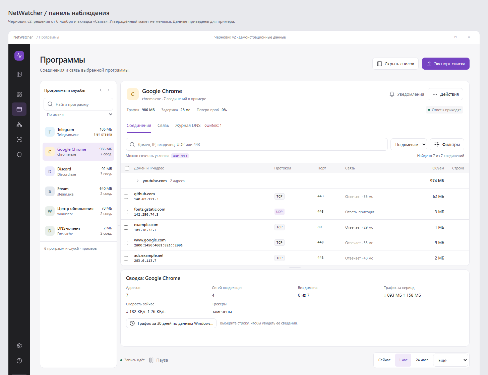
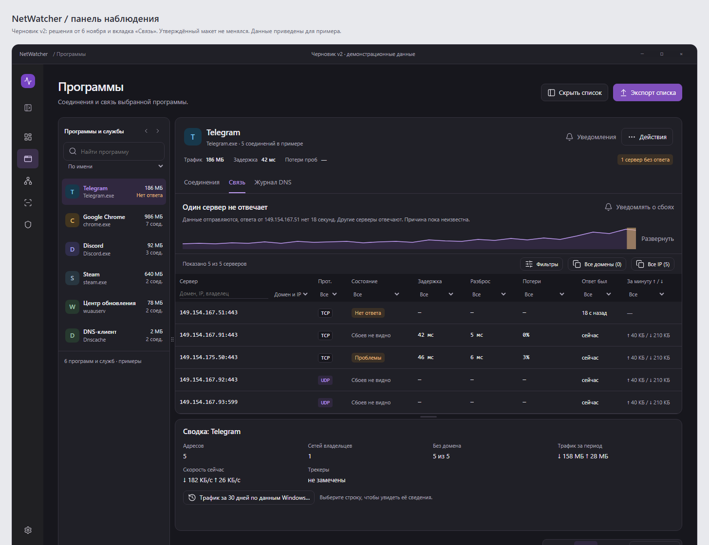
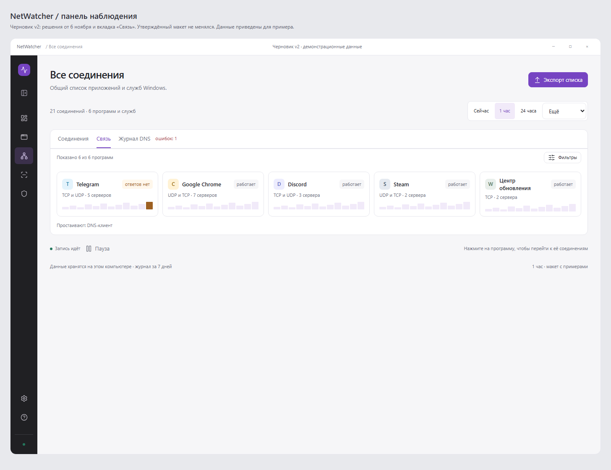

# NetWatcher

NetWatcher показывает, какие программы на компьютере используют сеть, с какими серверами связываются и сколько данных передают. Помогает разобраться, когда пропадает связь, проверить сайт и сохранить адреса для настройки VPN или брандмауэра Windows.

[Скачать для Windows](https://github.com/aeyota93-cloud/NetWatcher/releases/latest) · [Что нового](https://github.com/aeyota93-cloud/NetWatcher/releases) · [Руководство](docs/guide.md)

Нужна 64-битная Windows 10 версии 1809 или новее либо Windows 11. Устанавливать .NET отдельно не нужно.

## Что можно сделать

- **Найти программу и её серверы.** Выберите приложение или службу Windows — NetWatcher покажет адреса, известные домены, владельцев сетей и объём трафика. Поиск помогает найти нужное соединение.
- **Посмотреть, когда пропадают ответы.** На вкладке «Связь» видны задержка, потери проверочных пакетов и перерывы в ответах. Серверы можно отфильтровать по каждому столбцу, а домен и IP — скопировать одной кнопкой. Можно включить уведомления для выбранной программы.
- **Проверить сайт или адрес.** Раздел «Проверки» запускает несколько проверок соединения и объясняет результат. Отчёт можно скопировать и отправить тому, кто помогает разобраться.
- **Оценить подключение под нагрузкой.** Посмотрите, как меняется задержка во время загрузок. Отдельный тест покажет скорость скачивания и отправки; он расходует трафик.
- **Сохранить список адресов.** Экспорт готовит IP, домены и сети для WireGuard, AmneziaWG, брандмауэра Windows и роутеров. Перед копированием виден результат.
- **Ограничить соединения.** Через меню строки можно заблокировать программу, службу, адрес или домен. Правила действуют и после закрытия NetWatcher; снять их можно в разделе «Блокировки».

Обращения сохраняются в журнале на компьютере. По умолчанию история хранится 7 дней — срок можно изменить в настройках.

## Как начать

1. Откройте [последний релиз](https://github.com/aeyota93-cloud/NetWatcher/releases/latest) и скачайте `NetWatcher-win-x64.zip`.
2. Распакуйте архив и запустите `NetWatcher.exe`.
3. Разрешите запуск с правами администратора, если Windows их запросит. Эти права нужны для наблюдения за связью и полного сбора сетевых событий.
4. В меню слева откройте «Обзор», «Программы» или «Все соединения». У программы на вкладке «Соединения» видны её адреса, на вкладке «Связь» — обмен с серверами.

Если Windows показывает «Windows защитила ваш компьютер», причина может быть в том, что у файла нет цифровой подписи. Если вы доверяете скачанному файлу, в окне предупреждения выберите **Подробнее → Выполнить в любом случае**.

## Как выглядит

На изображениях — макет интерфейса с демонстрационными данными. В приложении детали могут немного отличаться.



<details>
<summary>«Связь» в тёмной теме и карточки программ</summary>




</details>

## Как обновить

NetWatcher проверяет обновления при запуске и раз в сутки. Если доступна новая версия, появится кнопка «Обновить». После подтверждения программа скачает архив, проверит его контрольную сумму и перезапустится. Журнал, настройки и блокировки сохранятся.

**В версиях 0.8.0–0.8.1 кнопка может не реагировать.** Один раз обновите программу вручную: скачайте последний релиз, полностью закройте NetWatcher, включая значок в области уведомлений, и замените `NetWatcher.exe` файлом из архива. В 0.8.2 эта ошибка исправлена.

## Что учитывать

- NetWatcher показывает наблюдения и признаки сбоев. Отсутствие ответа не всегда означает обрыв: некоторые серверы не отвечают на проверочные пакеты.
- Домены видны не у всех соединений. Если программа использует собственный защищённый DNS или узнала адрес до запуска NetWatcher, имя может не определиться.
- Страна и пометки вроде «трекер» берутся из справочников. Они могут ошибаться и не подтверждают назначение конкретного соединения.
- Блокировка домена работает по его IP-адресам. Общий адрес может использоваться другими сайтами; новые адреса могут пропустить первое соединение.
- Тест под нагрузкой расходует до 250 МБ на скачивание и до 100 МБ на отправку, плюс данные, которые уже передаются. Учитывайте это при ограниченном трафике.

Подробности, способы проверки и ограничения описаны в [руководстве](docs/guide.md).

## Где хранятся данные

Журнал, настройки, блокировки и справочники находятся в `%LOCALAPPDATA%\NetWatcher`. NetWatcher использует сетевые события Windows и не читает содержимое переписки или передаваемых файлов.

Программа обращается в интернет для проверок связи, проверки обновлений и загрузки справочников, а также по вашим командам — например, при проверке сайта или тесте скорости. Источники данных перечислены в [руководстве](docs/guide.md#откуда-берутся-данные).

Для каталога доменов действует ограничение на коммерческое использование. Источники и условия использования сторонних данных и кода указаны в [THIRD-PARTY-NOTICES.md](THIRD-PARTY-NOTICES.md).

## Сборка из исходников

Нужен .NET SDK 10. Тесты ядра можно запустить отдельно:

```bash
dotnet test tests/NetWatcher.Core.Tests -c Release
```

В Windows можно проверить всё решение, включая привязки кнопок интерфейса:

```bash
dotnet test NetWatcher.sln -c Release
```

Сборка программы для Windows:

```bash
dotnet publish src/NetWatcher.App -c Release -r win-x64 -o artifacts/publish
```

В `src/NetWatcher.Core` находится ядро программы, в `src/NetWatcher.App` — интерфейс и работа с Windows, в `tests` — тесты. Порядок выпуска версии описан в [памятке](docs/releases/ABOUT.md).
