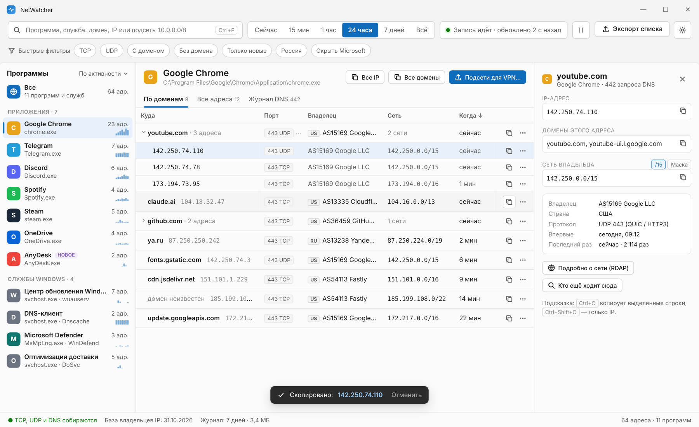
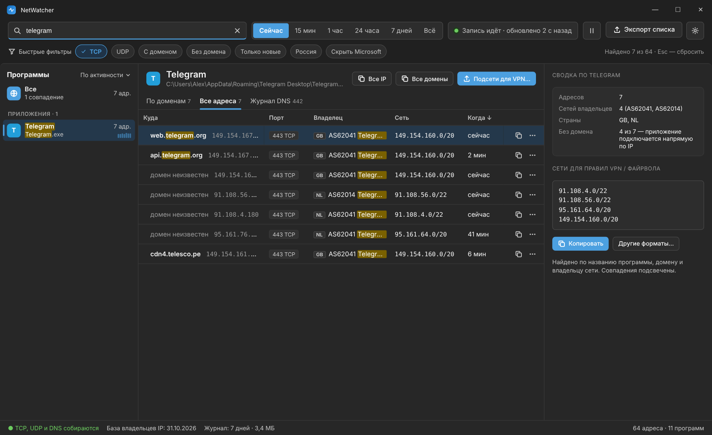
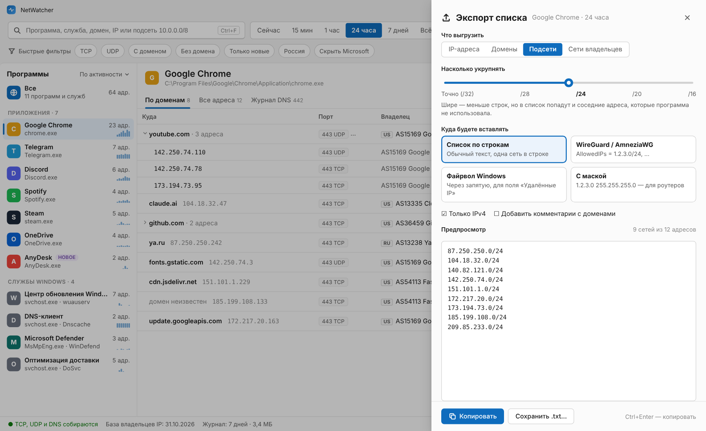
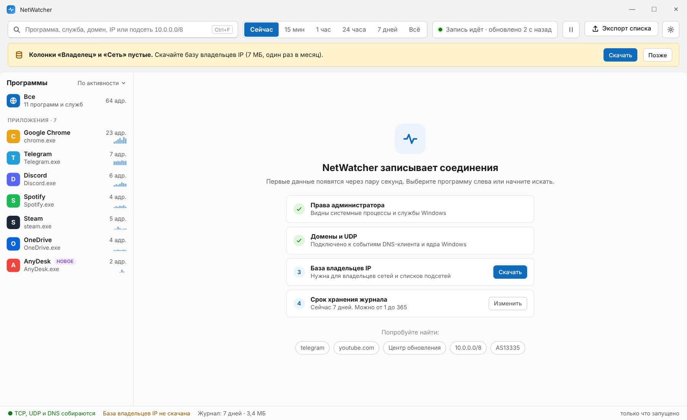

# NetWatcher

Лёгкий анализатор сетевых соединений для Windows. Показывает, какие программы
и службы ходят на какие IP-адреса и домены, и хранит это в журнале за несколько дней.

## Как выглядит

Макеты интерфейса (данные демонстрационные):



<details>
<summary>Поиск в тёмной теме, экспорт списка, первый запуск</summary>





</details>

## Что умеет

- **Программы и службы слева.** Разделены на «Приложения» и «Службы Windows». Службы из
  `svchost.exe` показаны по-человечески: «Центр обновления Windows», а не `svchost`.
  У каждой — число адресов, мини-график активности за 7 часов и метка **НОВОЕ**, если
  программа впервые вышла в сеть за последние сутки. Порядок — по активности или по имени.
- **Программа → домен → адреса.** Вкладка «По доменам» складывает адреса под их домен
  (как в Little Snitch), «Все адреса» — плоский список с сортировкой по колонкам,
  «Журнал DNS» — какие имена программа спрашивала и какие адреса получила.
- **Поиск и быстрые фильтры.** Поиск по всему сразу: программа, служба, IP, порт, домен,
  владелец, страна; подсеть `142.250.0.0/15` находит адреса внутри неё. Фильтры в один клик:
  TCP, UDP, «С доменом», «Без домена», «Только новые», «Скрыть Microsoft», «Только IPv4».
  Счётчик «Найдено 7 из 64», `Esc` — сбросить.
- **Период** переключателем: сейчас, 15 минут, час, сутки, неделя, всё. Журнал хранится
  столько дней, сколько задано в настройках (по умолчанию 7).
- **Карточка адреса справа.** IP, домены, сеть владельца (`/24` или маска), владелец, страна,
  протокол, когда впервые и в последний раз. У каждого поля кнопка копирования. Тут же
  «Подробно о сети (RDAP)» — данные регистратора — и «Кто ещё ходит сюда».
  Без выделения — сводка по программе и готовый список сетей для VPN или файрвола.
- **Копирование везде.** Кнопка в строке, меню «⋯», `Ctrl+C` — строки для Excel,
  `Ctrl+Shift+C` — только IP, двойной щелчок — IP. Внизу появляется подтверждение
  с кнопкой «Отменить».
- **Экспорт списка** (`Ctrl+E` или «Подсети для VPN…»): IP, домены, подсети или сети
  владельцев; ползунок «насколько укрупнять» от точных адресов до /16; формат под место
  вставки — список по строкам, WireGuard/AmneziaWG (`AllowedIPs = …`), файрвол Windows
  (через запятую) или с маской для роутеров; комментарии с доменами; предпросмотр.
- **Понятные владельцы сетей.** `AS8075 · Microsoft` вместо `MICROSOFT-CORP-MSN-AS-BLOCK`: названия
  из реестра очищены, у известных сетей — привычные имена. Полное название из реестра — во всплывающей
  подсказке. Кнопка «Владелец (PeeringDB)» уточняет название и тип сети по открытому справочнику
  PeeringDB (провайдер, CDN, магистральный оператор…); ответ запоминается.
- **Почему не работает.**
  - Сам по себе NetWatcher замечает проблемы: адреса, которые не отвечают на подключение,
    подключаются с повторами или теряют пакеты, помечены ⚠ / ✕, у программы — счётчик проблем,
    фильтр «Проблемные». В «Журнале DNS» видны неудачные запросы: «домен не существует»,
    «DNS-сервер не ответил», «ответ-заглушка 0.0.0.0» (блокировка через DNS).
  - Кнопка **«Проверить»** (`Ctrl+D`) проверяет сайт или адрес по шагам и даёт вердикт:
    DNS (системный и независимый DNS через HTTPS) → подключение → защищённое соединение
    (с настоящим именем сайта и с другим — так видна блокировка по имени, DPI) → задержка и
    потери → трасса с владельцем каждого узла и местом обрыва: роутер, провайдер, промежуточная
    сеть или сеть сайта. «Копировать отчёт» — текст для чата.
- **Светлая и тёмная тема**: кнопка-меню в панели — «Как в Windows», «Светлая», «Тёмная».
  Стандартные элементы — в стиле Windows 11.
- **Подсказки при первом запуске**: что уже работает, что нужно сделать, примеры поиска.

### Клавиши

| Клавиша | Что делает |
|---|---|
| `Ctrl+F` | Поиск |
| `Esc` | Закрыть экспорт или сбросить поиск и фильтры |
| `Ctrl+D` | Проверить соединение (выделенную строку или любой сайт) |
| `Ctrl+E` | Экспорт списка |
| `Ctrl+Enter` | Скопировать из панели экспорта |
| `Ctrl+C` / `Ctrl+Shift+C` | Копировать строки / только IP |
| `Пробел`, `→`, `←` | Раскрыть или свернуть домен |
| `F5` | Обновить |

## Как запустить

1. Скачайте `NetWatcher-win-x64.zip` из раздела Releases (или из Actions → последняя сборка → Artifacts).
2. Распакуйте и запустите `NetWatcher.exe`. Устанавливать .NET не нужно.
3. Windows попросит права администратора. Без них не видно системных процессов,
   доменов и UDP-соединений.
4. Нажмите **Скачать** в жёлтой плашке сверху: база владельцев IP, около 7 МБ.
   Без неё колонки «Владелец» и «Сеть» будут пустыми, остальное работает.

Нужна Windows 10 или 11, 64-битная.

### Предупреждение «Windows защитила ваш компьютер»

Файл не подписан цифровой подписью, поэтому SmartScreen (фильтр Windows для скачанных
программ) предупреждает о нём. Два способа запустить:

- в окне предупреждения нажать **Подробнее → Выполнить в любом случае**;
- или заранее: правой кнопкой по `NetWatcher.exe` → **Свойства** → галочка **Разблокировать** → ОК.
  Тогда Windows не считает файл скачанным из интернета и не предупреждает.

### Как выпустить новую версию

GitHub → Actions → **build** → **Run workflow**, в поле «Версия» написать, например, `v0.2.0`.
Сборка создаст релиз с архивом в разделе Releases.

## Откуда берутся данные

| Что | Откуда |
|---|---|
| Соединения TCP и номер процесса | Таблица соединений Windows (то же, что `netstat -ano`), опрос раз в 2 секунды |
| Короткие соединения и UDP (в том числе QUIC/HTTP3) | События ядра Windows (ETW — встроенная трассировка событий) |
| Домены | События DNS-клиента Windows: «программа спросила имя — получила такие IP» |
| Службы в svchost | Диспетчер служб Windows |
| Владелец и сеть | Офлайн-база [iptoasn.com](https://iptoasn.com) |
| Подробности о сети | RDAP через [rdap.org](https://rdap.org), только по кнопке |
| Название и тип сети | [PeeringDB](https://www.peeringdb.com), только по кнопке, ответы запоминаются |
| Ошибки DNS, зависшие подключения, повторные отправки | События DNS-клиента и TCP/IP ядра Windows, таблица соединений |
| Проверка соединения | Только по кнопке: системный DNS, DNS через HTTPS (Cloudflare, Google), подключение, TLS, ping, трассировка |

Всё хранится в `%LOCALAPPDATA%\NetWatcher`: журнал `log.db` (SQLite — база данных в одном файле),
настройки `settings.json` и база владельцев. В интернет приложение ходит только когда
вы скачиваете базу владельцев, нажимаете «Подробно о сети», «Владелец (PeeringDB)» или «Проверить».

## Ограничения

- **Трасса** идёт по ICMP — служебному протоколу, на котором работают ping и tracert. Многие узлы
  на него не отвечают — это нормально; важно, после какого узла не отвечает никто. С включённым
  VPN проверка и трасса идут через VPN.

- **Домен виден не всегда.** Если браузер использует свой «безопасный DNS» (DNS через HTTPS),
  он спрашивает имена в обход Windows, и их не видно. Для таких соединений будет только IP
  и владелец сети. Отключить можно в настройках браузера: Конфиденциальность → Безопасный DNS.
- Домены собираются с момента запуска. То, что программа узнала раньше и держит в своём
  кэше, будет без домена до следующего запроса.
- Один IP может обслуживать много сайтов (CDN). Тогда показываются домены, которые
  спрашивала именно эта программа, а если таких нет — последние известные.

## Сборка из исходников

Нужен .NET SDK 10.

```bash
dotnet test tests/NetWatcher.Core.Tests
```

```bash
dotnet publish src/NetWatcher.App -c Release -r win-x64 -o artifacts/publish
```

Проект собирается и на Linux (для CI), но запускается только в Windows.

Структура:

- `src/NetWatcher.Core` — не зависит от Windows: подсети и маски, база владельцев, RDAP,
  разбор DNS-ответов и таблицы TCP, журнал SQLite, поиск. Покрыто тестами.
- `src/NetWatcher.App` — приложение WPF: системные вызовы Windows, ETW, окна.
- `tests/NetWatcher.Core.Tests` — тесты ядра.
