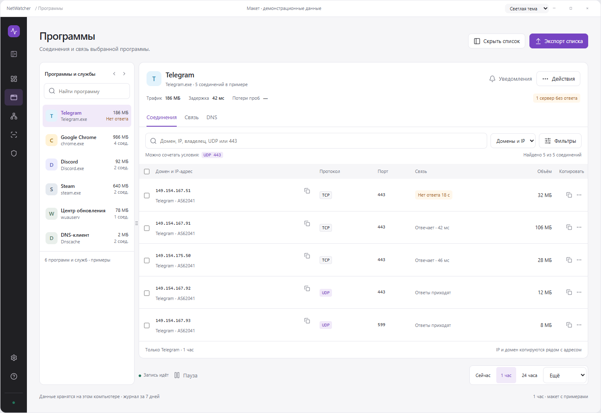
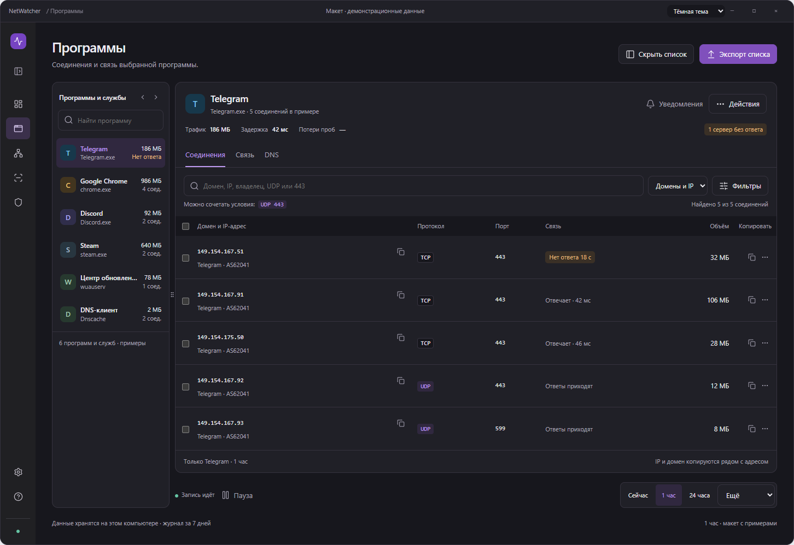
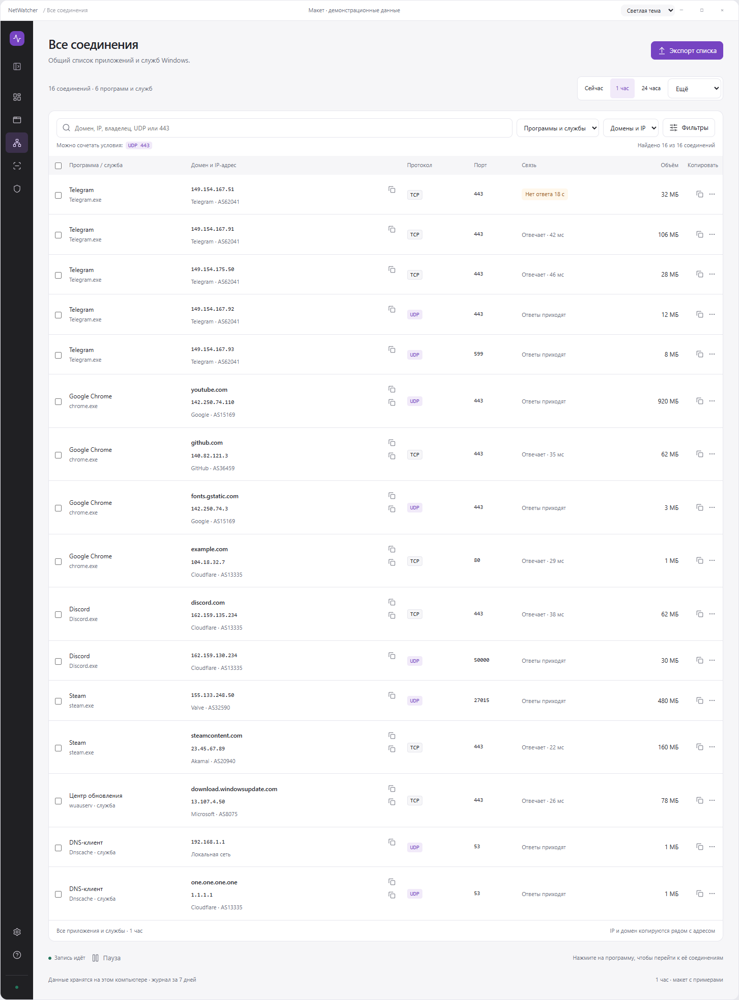
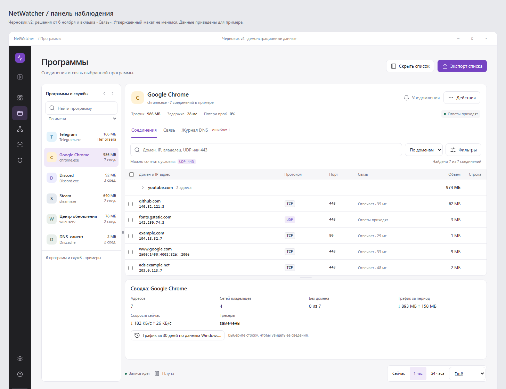
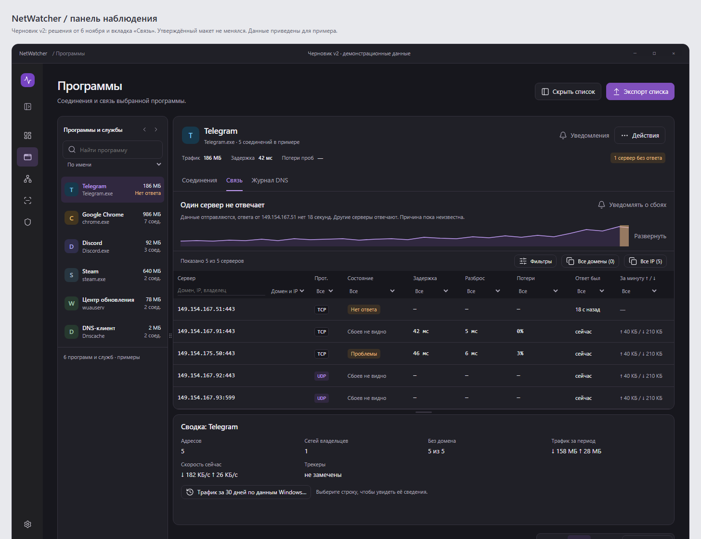

# Утверждённый редизайн NetWatcher

**Статус на 6 ноября 2026 года:** пользователь выбрал и одобрил обновлённую «Панель наблюдения». Перенос в WPF ещё не начат. Этот пакет передаёт Claude запрос, принятые решения, сам макет, функциональный diff и следующие шаги.

Общий вид одобрен. Полный функциональный паритет пока не подтверждён: аудит исходников выявил функции, которые не показаны или упрощены в макете. Их нельзя удалять на основании отсутствия на картинке. Аудит обновлён под версию 0.8.4, четыре решения пользователя записаны в `brief.md`.

## Что открыть

1. [Запрос и решения](brief.md) — что хотел пользователь, какой вариант выбрал и что добавил.
2. [Интерактивный макет](prototype/approved.html) — откройте локально в браузере. Установка и интернет не нужны.
   [Черновик v2](prototype/draft-v2.html) — тот же вид с решениями от 6 ноября и вкладкой «Связь». Утверждён 7 ноября 2026 года.
3. [Описание взаимодействий](interaction-spec.md) — меню, ширина списка, поиск, копирование и темы.
4. [Аудит и функциональный diff](audit.md) — текущие возможности, их отражение в макете и пробелы.
5. [План реализации и приёмка](implementation-plan.md) — порядок работ, ограничения и проверяемый результат.

## Как выглядит

### Программы: светлая тема

### Программы: тёмная тема

### Общий список соединений

Также доступны [тёмный общий список](images/connections-dark.png) и [обзор компьютера](images/overview-light.png).

### Черновик v2

Также доступны [общий список](images/v2-connections-light.png) и [карточки связи](images/v2-link-all-light.png).

## Как понимать файлы

- `prototype/approved.html` — автономная версия одобренного макета с локальными демонстрационными данными. Это визуальный и сценарный ориентир, а не приложение и не новый стек для NetWatcher.
- `prototype/approved-fragment.html` — исходный фрагмент макета: разметка, стили и сценарии. Он рассчитан на окружение предпросмотра с Lucide; для самостоятельного просмотра используйте `approved.html`.
- `images/` — состояния одного выбранного направления. Это не набор альтернативных вариантов.
- `reference.png` — исходный референс пользователя. Он задавал настроение и компоновку; приоритет имеет одобренный макет, а не интерфейс базы данных на референсе.
- `audit.md` — функциональное сравнение исходного WPF-интерфейса и поведения HTML-макета. У WPF нет DOM и `div`; буквальный DOM-diff здесь не подходит.
- `asset-manifest.json` — контрольные суммы перенесённых материалов.
- `LUCIDE-LICENSE.txt` — лицензия значков, встроенных в автономный макет.

Макет не выполняет сетевые проверки, не создаёт правила брандмауэра и не меняет настройки Windows. Период и часть служебных экранов показывают сценарий на примерах. Возможность сохранить или скопировать демонстрационный текст не означает готовность соответствующего WPF-сценария.

Реализация должна сохранить текущий движок, журнал, настройки и системные операции. Недостающие детали сначала согласуются на уровне дополнительного макета или явного описания; основной вид не нужно проектировать заново.
